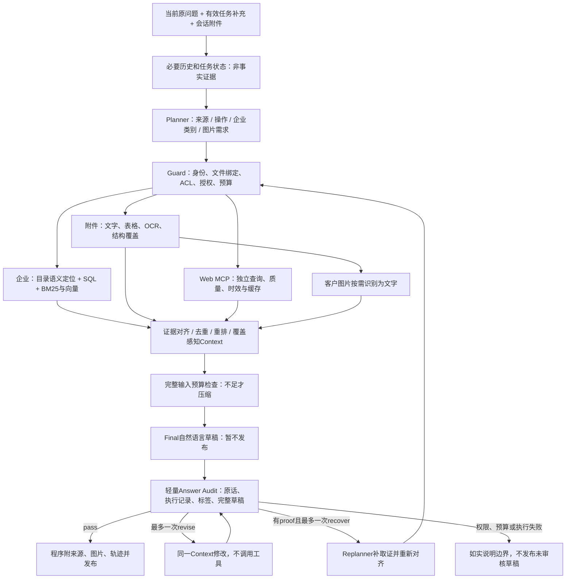

# 企业多模态 RAG Agent：建材知识助手

面向企业资料问答、客户文件分析和图片外观比较的本地 Agent 工程。以河北大自然石材有限公司的真岩系列公开资料作为领域案例，展示**规划与执行分工、关系检索、上下文管理、多模态证据化和有限恢复**。不是厂商官方服务，也不是产品性能背书。

**状态：持续迭代，尚未完成正式评测。** 本版提供代码、100题评测设计和示意轨迹，不发布准确率、历史评测结果或客户记录。代码检查不等于模型语义评测。[限制](docs/LIMITATIONS.md) · [资料与权利声明](docs/SOURCES.md)

## 分层阅读路径

| 层级 | 阅读内容 | 重点 |
|---|---|---|
| 1 | 本页 | 目标、Agent数据流、工程设计 |
| 2 | [架构](docs/ARCHITECTURE.md) | LangGraph、CPU/GPU、有限循环 |
| 3 | [知识库与数据库](docs/KNOWLEDGE.md) / [资料接入](docs/INGESTION.md) / [Web工具](docs/WEB.md) | 六大类、SQL、向量/BM25、MCP |
| 4 | [字段与回退](docs/CONTRACTS.md) / [Prompt](docs/PROMPTS.md) | 模型选择什么、程序派生什么 |
| 5 | [上下文与预算](docs/CONTEXT.md) | 历史、任务状态、压缩、扩展 |
| 6 | [多模态与全部分支轨迹](docs/TRACES.md) | 来源、任务、模态和恢复的执行差异 |
| 7 | [100题评测设计](docs/EVALUATION.md) / [题库](data/sales/evaluation/agent_eval_100_v1/questions.jsonl) | 分配原因、复现与判分 |
| 8 | [运行](docs/RUNNING.md) / [全模块代码地图](docs/CODEMAP.md) | 环境、入口、源码导航 |

## Agent数据流



图是条件数据流，不表示每题都执行所有节点或GPU并行。普通交流可跳过取证；轻量审核不是逐句事实认证。

## 工程重点

- Planner只做语义决策；ID、权限、执行范围、覆盖和Token额度属于程序。
- SQL管理实体和关系，BM25与Embedding互补，Qdrant是可选本地向量服务，仍保留NPZ路径。
- lookup/comparison保留Requirement归属；summary按集合/章节覆盖，排序Top-K不是完整目录。
- 企业图只用标签；客户图按需读像素形成文字；展示与识别独立，审核不读原图。
- 完整包装输入统一计数，够就保留，不够才压缩；草稿完成后再计真实审核输入。
- 最多一次工具语义恢复、一次原Context答案修改；最多两次格式重试是独立机制。
- 节点可观测耗时、Token、来源和范围；公开用户只看自己的轨迹，管理员全局视图仍鉴权。
- 模型可独立常驻，闲置20分钟卸载；GPU生成串行，CPU独立召回有界并行。

## 仓库结构

```text
backend/app.py                 FastAPI与执行回调
backend/sales/                 Planner、Graph、检索、预算、审核、模型服务
backend/documents/             附件、层级、视觉、Owner隔离
backend/document_parsing/      通用解析组件，不发布财务业务
frontend/app/sales/            对话、队列、附件、来源、轨迹
data/sales/evaluation/         100题与自造fixture，无结果
examples/traces/               示意轨迹，不是实测日志
scripts/                      启动、构建、评测、检查
docs/                         分层设计与代码地图
```

按[运行说明](docs/RUNNING.md)配置模型和数据。仓库不包含模型权重、完整企业库、客户附件、密钥、会话数据库或向量索引，不是下载即用的托管服务。

```bash
python scripts/run_agent_eval_100.py  # 只验证题库，不调用模型或Web
python scripts/run_agent_eval_100.py --run --group attachment
```

根据项目作者说明，企业资料来自互联网公开渠道；项目用于个人学习、研究和面试展示，不用于盈利，不代表厂商。公开可访问不等于允许重新分发，默认只发布代码、来源说明与自造fixture，不上传第三方原始文档和图片。[来源与许可边界](docs/SOURCES.md)
