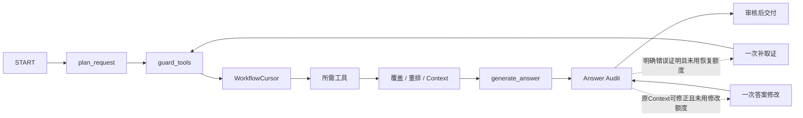

# Agent整体架构

[首页](../README.md) → 本页 → [字段](CONTRACTS.md) → [轨迹](TRACES.md)

## 三层职责

| 层 | 负责 | 不负责 |
|---|---|---|
| 模型语义层 | 规划、视觉理解、草稿、完成度审核、有限重规划 | ID、ACL、额度 |
| 程序与工具 | 目录/关系、绑定、召回/重排、计数、执行/取消 | 凭候选数量认证事实 |
| 状态与交付 | 原话链、Owner会话、轨迹、来源图片、审核后发布 | 把历史答案当技术证据 |

[answer_graph.py](../backend/sales/answer_graph.py)负责有限编排；[staged_execution.py](../backend/sales/staged_execution.py)负责真实工作游标；[app.py](../backend/app.py)是HTTP与回调入口。

## LangGraph

维护请求、plan_history、工具结果、current_sources、响应和node_trace。plan_request → guard_tools → WorkflowCursor条件执行所需来源 → assess_coverage/rerank_evidence/compose_evidence → generate_answer → 审核与交付。兼容路径和不同来源可能跳过节点，不是每题固定完整执行。

Graph没有持久化checkpointer；SQLite任务记忆/审计不等于任意节点断点续跑。草稿不会先公开再审核。

## 三种独立恢复

| 类型 | 条件与动作 | 上限 |
|---|---|---|
| 格式协议 | JSON结构/字段/取值/输出契约失败，反馈具体错误 | 两次额外格式重试 |
| 工具语义 | proof证明范围错配、未执行或客户视觉缺口且资源允许 | 一次Replan |
| 答案修改 | 漏答/偏题/标签越界能在原Context修正 | 一次，无新工具 |

不因失败重跑整条工作流，不扩大权限，恢复后重新对齐证据并审核。[recovery_budget.py](../backend/sales/recovery_budget.py) · [gap_recovery.py](../backend/sales/gap_recovery.py) · [model_contract.py](../backend/sales/model_contract.py)

## 并行与串行

[parallel_reads.py](../backend/sales/parallel_reads.py)仅并行两项独立CPU只读召回，复制ACL/取消ContextVar，汇合后融合重排；取消仍等待已启动原生运算释放请求槽。Planner、必要视觉、Final、Audit依赖串行，单卡GPU不并行生成。CPU检索模型部署是资源隔离策略，不保证更快。

## 服务和交互

[model_service.py](../backend/sales/model_service.py)与[model_transport.py](../backend/sales/model_transport.py)支持本地认证tensor RPC，保留embedded模式。服务模式下业务API重启不结束模型服务；闲置1200秒卸载权重，服务等待下一次加载。不上公开云端推理，不使用pickle。

前端方块/箭头控件支持停止、独立排队与补充调整；独立排队不合并，正在执行的补充保存有效原话链再规划。取消安全检查点生效，不能宣称立即释放GPU。后端重启会使进程内附件会话失效，不删除企业资料或历史。[page.tsx](../frontend/app/sales/page.tsx)

公开轨迹Owner隔离，管理员全局视图仍需鉴权；图片归属和ID由后端控制。Token按实际调用记录，父子节点不得双计，未知值不写成0。[access_control.py](../backend/access_control.py) · [ownership.py](../backend/documents/ownership.py) · [token_usage.py](../backend/sales/token_usage.py)
