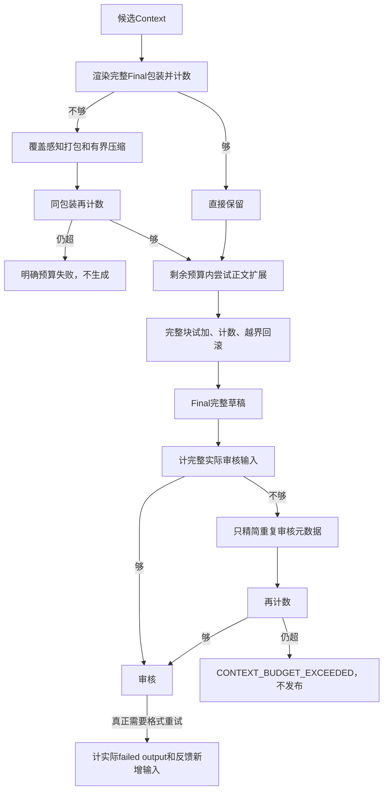

# 上下文、压缩、扩展和预算

[首页](../README.md) → 本页 → [轨迹](TRACES.md)

## 上下文分层

| 类型 | 进入方式 | 边界 |
|---|---|---|
| 当前原问题 | 当前用户输入 | 权威任务要求，不是外部事实 |
| 未完成任务补充 | 原话链按时间保存 | 追加保留、纠正替换冲突、明确取消才删除 |
| 历史与记忆 | 最近一轮交流 + Owner/thread内相关记忆 | technical_evidence=false，不复用旧助手技术结论 |
| 本轮证据Context | 授权工具真实返回、范围对齐与打包 | 候选存在不保证事实支持 |

[task_memory.py](../backend/sales/task_memory.py)当前支持本地语义Embedding相关召回，异常可词法回退，保留7天，不读取无限全历史。清除任务记忆不删除知识库。[task_updates.py](../backend/sales/task_updates.py)针对正在执行任务保存原话链并更新要求；独立排队不合并。当前实现不是通用持久化TaskSpec版本库，不把设计建议写成已实现。

## Requirement和集合

lookup/comparison的Requirement由工具绑定目录/会话身份，包含requirement_id、target_kind/id/name、aspect，候选携带requirement_ids；summary主要走集合/文档章节覆盖。[requirements.py](../backend/sales/requirements.py)

比较A/B厚度与安装：分别召回 → 去重但保留R归属 → 联合重排 → 覆盖代表证据。represented只是候选覆盖，不是语义认证；没有解析的对象保留范围缺口，不静默猜选。

## CPU压缩，不新增摘要模型

| 操作 | 触发 | 方法 |
|---|---|---|
| 索引去重 | 接入 | 同文去重保留ACL、来源、短表格上下文 |
| 模型视图精简 | 包装 | 去遥测/重复导航，保留事实与标签 |
| Context选择/压缩 | 完整输入超预算 | 问题相关窗口、完整句段、数值/单位/否定/条件/表格保护及覆盖优先 |
| 正文扩展 | 目录/摘要正文有限且有预算 | 同授权源完整块，试加计数，超限回滚 |
| 审核元数据精简 | 完整实际审核超预算 | 重复执行/导航元数据无损精简，不删Final或标签边界 |

[knowledge_compaction.py](../backend/sales/knowledge_compaction.py) · [evidence_packing.py](../backend/sales/evidence_packing.py) · [support_compression.py](../backend/sales/support_compression.py) · [evidence_expansion.py](../backend/sales/evidence_expansion.py) · [review_execution.py](../backend/sales/review_execution.py)

这些方法有结构和问题相关性，不是额外Qwen语义摘要，也不保证语义无损。

预检发生在对应模型调用之前。审核计入系统、原话、状态、标签和完整草稿；视觉预算不只文字长度。[final_input.py](../backend/sales/final_input.py)与实际包装共用计数入口。

当前[review_budget.py](../backend/sales/review_budget.py)审核输入8000、输出384；Final程序另有硬输出上限，Prompt提示正文约2000字，字数不是Token额度。第一次审核不预扣假设的格式重试，真正重试才计完整重试输入；放不下就明确失败，不削掉未审核正文蒙混通过。

最小完整块不能放下则不扩展，记录budget_insufficient/budget_boundary_rollback和正文未补齐，不声称已看全文。[gap_recovery.py](../backend/sales/gap_recovery.py)第二轮去重与溯源合并后还需范围约束，旧日期/对象不支持新要求；冲突不能仅凭第二轮更新自动裁决。该机制不等于已实现无限通用事实冲突识别。[query_constraints.py](../backend/sales/query_constraints.py)
