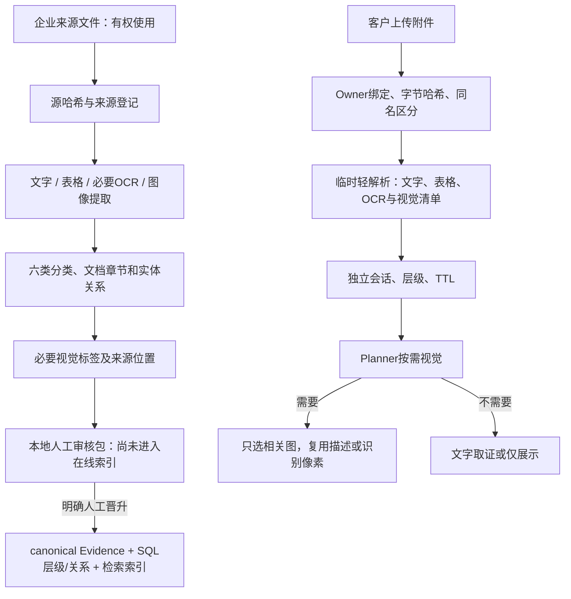

# 长期资料接入与临时附件

[首页](../README.md) → [知识库](KNOWLEDGE.md) → 本页

[ingestion_graph.py](../backend/sales/ingestion_graph.py)是review-first流程，默认止于本地审核包，不自行改在线库、不自动上传云。晋升后才构建目录/索引。接入分类、来源权威和ACL分别管理：标准、公司宣传、产品比较、检测样品不能混成同一事实口径。

文字Evidence保留页码、章节、表格sheet/range及来源；图像以文件哈希、asset_id、source occurrence保留多处来源关联。去重不能丢失不同项目/不同样品的短表格上下文。

[customer_sessions.py](../backend/documents/customer_sessions.py)仅建立客户临时会话，不自动进入公司索引。原始file_name和显示display_name分离；相同字节重复提示，不同内容同名保留两个对象，不能用文件名判重复。后端仍复核身份，前端哈希不是权限依据。默认全选有效附件；明确“只看某个”才缩小，名称由当前Owner会话精确绑定。

图片清单只证明提取了视觉资产，不证明已理解像素；OCR也不证明隐藏构造。客户视觉描述包含labels、description、visible_text、relations和uncertainties，归属明确后进入文字Context。Audit可要求最多一次有权限的视觉恢复；公司标签不足只能说明缺口，不重看公司原图。

解析器支持多个文件格式，但业务路由不能靠扩展名猜问题领域；具体解析结构决定取证单位。OCR和视觉是可选/按需增强，不假定每张图片都有完整标签。[evidence_v2.py](../backend/documents/evidence_v2.py) · [visual_evidence.py](../backend/sales/visual_evidence.py)
