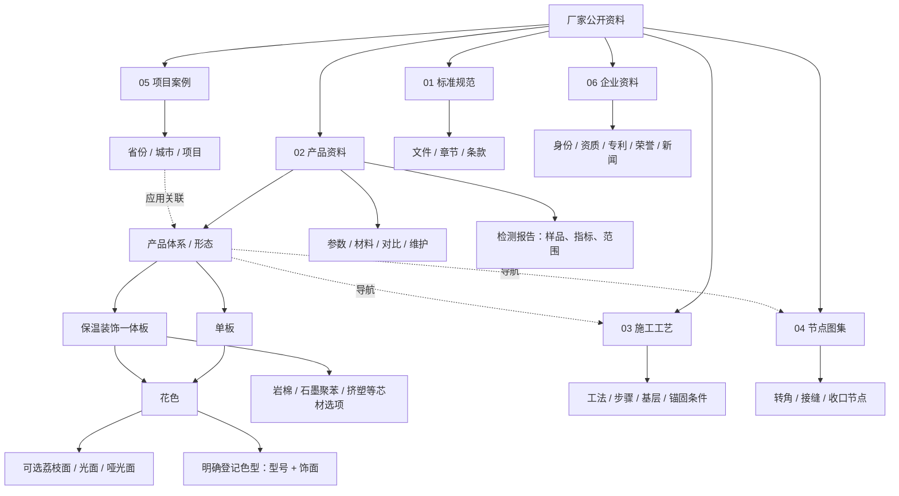

# 厂家六大类与数据库

[首页](../README.md) → 本页 → [Context](CONTEXT.md)

以下是概念导航图，不保证所有组合都有型号、检测或图片。分类权威：[content_taxonomy.py](../backend/sales/content_taxonomy.py)。



六类是资料用途，不是六种产品。花色/饰面/芯材是属性层，不能与单板/一体板混算。检测报告是产品子类；图片挂在实体、文档、页码或节点，不是第七类。装饰线条不作为本演示独立产品，兼容代码仍可能存在历史词汇，不代表有效目录登记。

## SQL关系

[catalog_store.py](../backend/sales/catalog_store.py)、[knowledge_hierarchy.py](../backend/sales/knowledge_hierarchy.py)、[relation_scope.py](../backend/sales/relation_scope.py)负责SQLite身份、层级、权限与范围。

| 表组 | 示例 | 管理内容 |
|---|---|---|
| 实体 | products / product_families / project_cases / company_profile | 稳定ID、名称、地域 |
| 属性 | catalog_product_attributes / catalog_color_variants / catalog_core_variants / catalog_product_finish_options | 形态、花色、芯材、饰面 |
| 图文证据 | knowledge_documents / knowledge_text_evidence / knowledge_evidence_sources | 正文、ACL、来源位置 |
| 层级 | knowledge_document_nodes / knowledge_section_nodes / knowledge_node_evidence | 文档到章节到正文 |
| 关系 | family_section_links / project_product_links / node_asset_relations | 体系与施工/节点/项目 |
| 图片 | visual_files / visual_assets / visual_asset_labels / visual_source_occurrences | 原图、哈希、标签、位置 |

关系用于导航，不自动证明型号性能或工程合规。登记选项不虚构完整SKU。

## 混合检索

```text
有效原问题 → 六类优先范围 / 名称别名 / 目录语义排序 / 层级粒度
 → SQL关系范围 + 可访问证据ID
 → BM25关键词召回 ║ Embedding语义召回
 → RRF融合 / 候选保留 → Cross-Encoder重排
 → Requirement或集合覆盖保护 → 预算Context
```

[entity_directory.py](../backend/sales/entity_directory.py)用有效原问题定位名称/别名；不明确时保留候选、语义排序。其他类别按文档/章节/主题导航。类别是优先范围，不保证Planner正确；允许跨类关系及受控补搜，不默认召回全库。

[retriever.py](../backend/sales/retriever.py)没有唯一Top-K：retrieve入口默认top_k=5，关系/集合可调整；[requirements.py](../backend/sales/requirements.py)词法补充默认limit=3后联合重排，不等于最终只看三条。完整集合不能用目录Top3替代。

[vector_store.py](../backend/sales/vector_store.py)是Qdrant loopback适配；RAG_VECTOR_BACKEND默认npz，设qdrant才用独立向量库。集合按索引指纹版本化，查询预过滤可访问ID，返回复查ID/指纹。SQL与canonical index仍为身份/ACL/来源权威；向量服务异常有状态和词法降级，不能把空范围扩大为全库。

| operation | 含义 | 取证 |
|---|---|---|
| lookup | 具体内容，可多对象多维度 | 独立Query/Requirement绑定 |
| summary | 指定范围概括或集合列举 | 上层体系、成员/章节覆盖、必要正文 |
| comparison | 各方共同要求比较 | 分别召回并保留归属 |

unknown不允许Planner主动输出，但执行兼容路径仍可能用占位，不能写成第四种正式任务。
